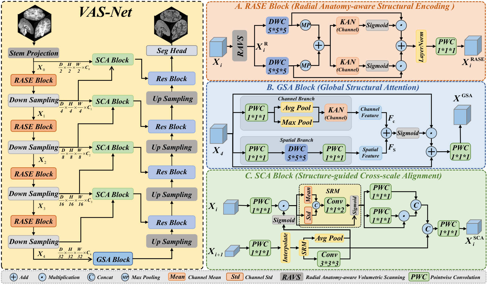
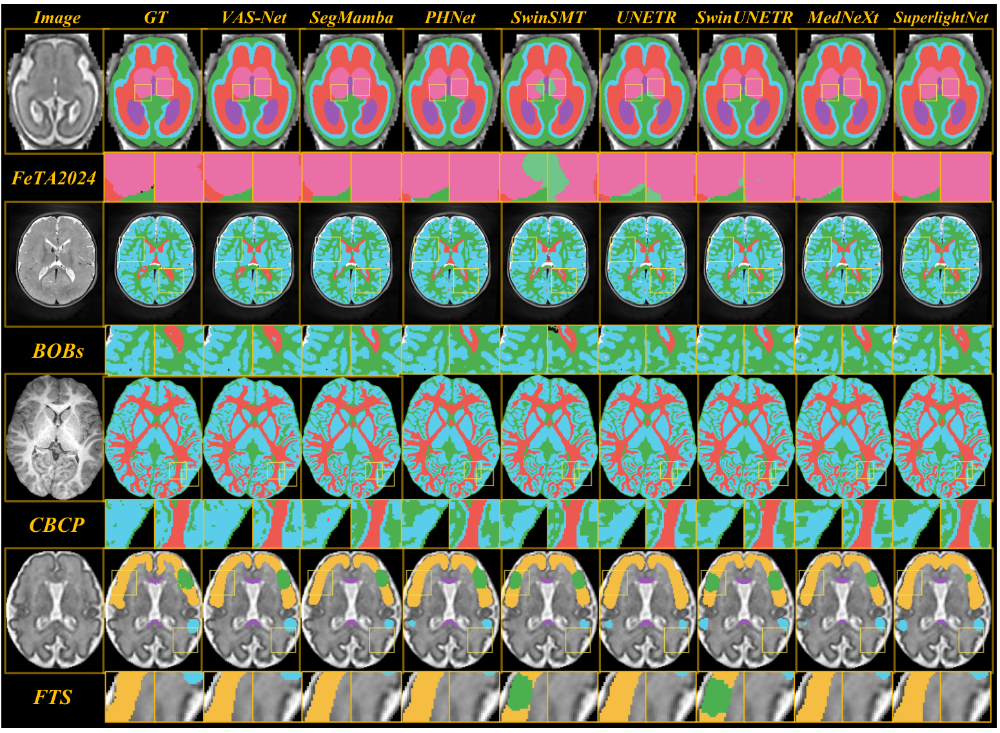

# VASNet

**Volumetric Anatomy-aware Structural Modeling for Perinatal Brain Tissue Segmentation**

Yueyue Zhu, Yuqi Zhang, Yu Guo, Zongjian Yang, Lanxiang Ma, Han Zhang, Jiquan Ma, and Geng Chen.

Implementation accompanying the **journal submission**. The manuscript calls the method **VAS-Net**; this repository and Python class use **VASNet**. Publication metadata will be updated after publication.

VASNet combines radial anatomy-aware structural encoding (**RASE**), global structural attention (**GSA**), and structure-guided cross-scale alignment (**SCA**) for volumetric perinatal brain MRI segmentation.



The figure is the submitted manuscript's schematic. Exact executable details and differences from the schematic are documented in [implementation notes](docs/IMPLEMENTATION.md).

## What is included

The model was recovered from the local `models/MambaUXV32.py` used by the VASNet FeTA, BOBs, CBCP and FTS scripts. This is a journal-model release, rather than a renamed conference model. Registered parameter names are retained for historical checkpoints. Source hashes and deliberate behavior changes are recorded in [source provenance](docs/SOURCE_PROVENANCE.json) and [implementation notes](docs/IMPLEMENTATION.md).

- Actual V32 model, including its Mamba branches, KAN fusion, GSA and SCA modules.
- Portable NIfTI preprocessing, patient-disjoint manifests, training, sliding-window prediction and physical-space evaluation.
- Separate `paper_adam` and `local_sgd` optimization profiles; the manuscript and recovered scripts specify different optimizers.
- Dataset configurations, tests and instructions. Training data, original subject splits and trained V32 checkpoints are **not included**.

Read [reproducibility notes](docs/REPRODUCIBILITY.md) before comparing against paper results. This release does not claim that new runs reproduce the submitted tables.

## Installation

Use a Linux NVIDIA CUDA environment (including an appropriately configured WSL2 installation). The model requires the real `mamba-ssm` implementation; there is no substitute SSM in production code.

```bash
conda create -n vasnet python=3.10 -y
conda activate vasnet
pip install torch==2.4.0 --index-url https://download.pytorch.org/whl/cu124
pip install -r requirements.txt
pip install -r requirements-cuda.txt --no-build-isolation
```

See [installation and GPU checks](docs/INSTALL.md). These pins are a target environment; full CUDA execution has not been verified on the Windows preparation machine.

## Prepare data

Use scalar 3-D NIfTI images and integer segmentation labels, including background `0`. Create your own patient-disjoint `training`, `validation` and `test` lists using [the manifest example](data/manifest.example.json). Paths are resolved relative to the manifest file. Examples contain fictional identifiers and no clinical records.

```bash
python Code/validate_manifest.py --config configs/feta.json --manifest /data/feta/manifest.json
```

Choose the physical spacing explicitly rather than applying one dataset's spacing to every dataset. For example, the recovered FTS preprocessing uses 0.8 mm isotropic spacing:

```bash
python Code/preprocess.py --config configs/fts.json --manifest /data/fts/manifest.json --spacing 0.8 0.8 0.8 --crop-nonzero --output /data/fts_prepared
```

Preprocessing preserves physical orientation and origin, uses linear image interpolation and nearest-neighbor label interpolation, and writes a new manifest. Foreground z-score normalization is applied when loading images. See [dataset and label requirements](docs/DATASETS.md).

## Train

Set the epoch count and steps per epoch explicitly; they are not recoverable as a single, consistent paper protocol. Example values below illustrate the command format and are not a claim about the paper's training duration.

```bash
python Code/train.py --config configs/feta.json --manifest /data/feta/manifest.json --profile paper_adam --epochs 1000 --steps-per-epoch 250 --batch-size 2 --device cuda:0 --output runs/feta_adam
```

`paper_adam`: Adam, learning rate 1e-4, cosine decay, cross-entropy. `local_sgd`: SGD, learning rate 1e-2, momentum 0.99, Nesterov, weight decay 3e-5, polynomial decay with power 0.9. The latter matches the optimization settings found in the local scripts; the portable loader and sampling loop are newly organized code.

The model requires **128 x 128 x 128** input patches and batch size **at least 2** for training. `last.pt` stores optimizer, scheduler and RNG states; `best.pt` is selected by validation foreground mean Dice. Resume a run with the same settings and `--resume runs/feta_adam/last.pt`.

## Predict and evaluate

```bash
python Code/predict.py --config configs/feta.json --manifest /data/feta/manifest.json --checkpoint /checkpoints/feta.pt --output predictions/feta --device cuda:0
python Code/evaluate.py --config configs/feta.json --manifest /data/feta/manifest.json --predictions predictions/feta/predictions.json --output results/feta.json
```

Prediction uses Gaussian sliding windows, 50% overlap and multiclass argmax. `--mirror` enables eight mirrored views. Fixed scan orientation is the default; `--scan legacy_random` restores the recovered source's random scan orientation during evaluation. Strict weight loading prevents silently running a partially loaded model.

If images were resampled or cropped, use `--reference-manifest /data/original/manifest.json` during prediction to restore masks to the original grid. Then evaluate against that same original manifest. Without it, predictions retain the input grid.

## Results reported in the submitted manuscript

These are transcribed manuscript results, **not measurements produced by this release**. Dice and IoU are percentages; ASD is in mm.

| Dataset | Dice ↑ | IoU ↑ | ASD ↓ |
|---|---:|---:|---:|
| FeTA | 88.86 | 80.21 | 0.45 |
| BOBs | 88.57 | 79.62 | 0.35 |
| CBCP | 94.12 | 88.92 | 0.17 |
| FTS | 74.88 | 60.85 | 0.61 |



## Code map

| File | Purpose |
|---|---|
| `Code/models/VASNet.py` | Checkpoint-compatible V32 architecture |
| `Code/vasnet/` | Configuration, IO, metrics and inference helpers |
| `Code/train.py` | Explicit optimization profiles and resume support |
| `Code/preprocess.py` | Physical-space resampling and optional cropping |
| `Code/predict.py` | Window inference and optional original-grid restoration |
| `Code/evaluate.py` | Per-case/per-class Dice, IoU and ASD with empty-mask reporting |
| `docs/MIGRATION.md` | Changes from the conference ZIP |
| `docs/VALIDATION.md` | Checks performed and remaining validation limits |

## Tests

```bash
pip install -r requirements-dev.txt
python -m pytest -q
python Code/smoke_cuda.py --classes 8
python Code/smoke_cuda.py --classes 8 --backward
```

CPU tests use a clearly marked test-only sequence layer to exercise scan plumbing and module wiring. They do not validate selective-scan CUDA kernels, model accuracy or complete GPU training.

## Citation and availability

Please cite the manuscript title and authors above while publication details are pending; [CITATION.cff](CITATION.cff) records the current unpublished status. No DOI or acceptance status is asserted. Data must be obtained from its respective providers; FTS is an institutional dataset subject to authorization.

The supplied conference archive had no top-level license grant. This preparation does not invent one. The authors should confirm the repository's license and third-party obligations before public redistribution. See [NOTICE](NOTICE).
